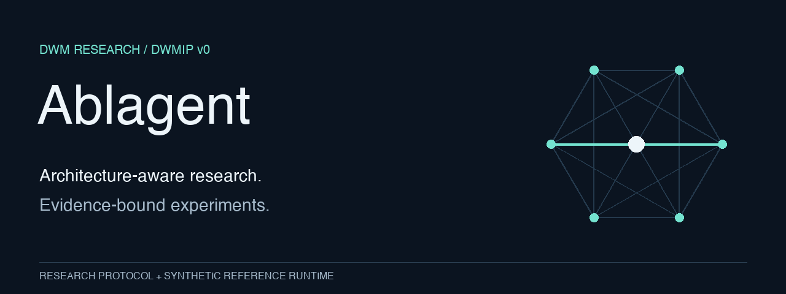
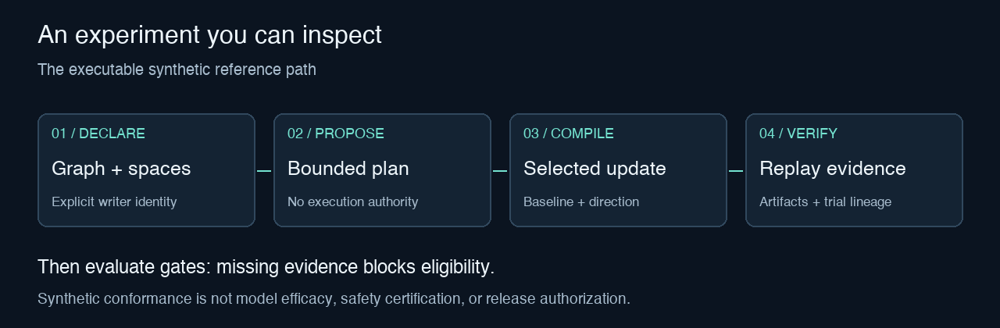

<p align="center">
  
</p>

<h1 align="center">Ablagent</h1>

<p align="center"><strong>Make the architecture explicit. Make the experiment inspectable.</strong></p>

<p align="center">
  A Domain Weight Modification research protocol and synthetic reference runtime.<br>
  Explicit spaces. Bounded proposals. Reproducible artifacts. Retained evidence.
</p>

<p align="center">
  <a href="#quickstart">Quickstart</a> ·
  <a href="docs/architecture-navigation.md">Architecture research</a> ·
  <a href="spec/dwmip/v0/README.md">DWMIP specification</a> ·
  <a href="docs/support-matrix.md">Support matrix</a> ·
  <a href="CONTRIBUTING.md">Contribute</a>
</p>

> **Research preview · synthetic alpha** — The CPU reference runtime runs today. Real-checkpoint adapters, neural activation capture, and serving are **not implemented**. Architecture coverage below is research guidance, not executable model support.

## Why Ablagent?

A tensor name is not an architecture. Matching dimensions do not establish compatible spaces. A saved weight edit is not evidence that an intervention worked.

Domain Weight Modification (DWM) research needs more than a transformation formula: it needs an explicit account of **where an intervention acts, what it changes, and how its result is checked**.

Ablagent brings those questions into one inspectable workflow. Its **DWM Interchange Protocol (DWMIP v0)** connects graph and writer identities, banks, directions, experiment plans, interventions, trials, and evidence. The synthetic runtime makes that contract executable before real-model adapters are introduced.

### What makes it different

- **Architecture semantics before edits.** Declare sites, spaces, axes, routes, and writers rather than guessing from names or shapes.
- **Proposals are not permissions.** The deterministic planner proposes bounded experiments; compilation requires an explicitly selected intervention.
- **Artifacts you can replay.** Canonical JSON, safe tensor storage, and digest-bound manifests let verification recompute the reference transformation and observations.
- **Negative results stay in the record.** Retain rejected trials, lineage, and missing-evidence states instead of presenting only successful candidates.
- **Research without inherited model baggage.** Original synthetic banks and general architecture guidance; no previous checkpoint work, private prompts, or model-specific recipes.

**Built for** researchers formalizing experiments, engineers qualifying architecture adapters, and agent developers who need a narrow, verifiable integration boundary. It is not yet a turnkey model editor or an autonomous LLM agent.

## What runs today

| Layer | Available now | Boundary |
|---|---|---|
| Reference math | Dense rank-one CPU update | One site, one direction, one writer |
| Experiment planning | Deterministic bounded proposals | No autonomous executor or provider integration |
| Artifact verification | Replayed transformation, observations, and trial lineage | Structural consistency, not behavioral proof |
| Banks and policy | Synthetic capture and inert mock fixtures; fail-closed gates | No real safety holdout or release authorization |
| Architecture navigation | Explicit contracts and qualification guidance | Complex architectures are descriptive, not executable |

The reference operation is `W′ = W − αd(dᵀW)`, with a normalized direction and an explicitly declared dense `out × in` writer. Its narrow scope is intentional: establish a testable contract rather than quietly treating every architecture as the same matrix.

See the [complete support matrix](docs/support-matrix.md) for precise limitations and the [verification record](docs/VERIFICATION.md) for locally measured checks.

## From a proposal to inspectable evidence



1. **Declare** the graph, spaces, writer, and immutable baseline.
2. **Propose** bounded interventions using a direction bound to that baseline.
3. **Compile** one selected intervention into a separate artifact.
4. **Verify** the transformation, stored observations, and selected trial chain.
5. **Evaluate** policy against verified evidence and the selected bank.

Here, **evidence-bound** means artifact identities and consistency checks—not independent attestation, scientific validity, or safety certification. Eligibility is never publication approval.

## Quickstart

**Python 3.11+ · CPU only · no GPU or model download required**

The commands below use a macOS/Linux shell. Clone this repository and run from its root. Installation needs access to Python dependencies; the reference workflow then runs locally without API keys or a network service.

```bash
python3 -m venv .venv
.venv/bin/python -m pip install -e '.[dev]'

# Inspect the runtime's declared capabilities.
.venv/bin/ablagent capabilities

# Run an original synthetic experiment into a fresh directory.
.venv/bin/ablagent demo --run-dir .runs/reference

# Recompute and verify the saved artifact.
.venv/bin/ablagent verify .runs/reference/candidate.manifest.json
```

**What you get:** a graph, baseline tensors, a bound direction, a proposed plan, a compiled candidate, retained trials, and an evidence bundle—not a modified language model.

Now check the gate:

```bash
.venv/bin/ablagent gate .runs/reference/candidate.evidence.json \
  --bank examples/banks/synthetic-release-mock.bank.json
```

**Expected: `blocked` with exit status `2`.** The demo intentionally lacks the required evidence. This demonstrates the fail-closed path; it is not a failed installation. Contract errors return `1`. There is no publish command.

Use a fresh run directory for each demo: existing artifacts are preserved rather than silently overwritten. Continue with the [full quickstart](docs/quickstart.md) to separate planning from compilation and inspect the artifact flow.

## Architecture research, without shortcuts

Different computation graphs require different intervention semantics. The research guide explains what an adapter must establish before claiming support.

| Architecture surface | Questions to resolve |
|---|---|
| Dense residual networks | Which residual site? Which writer? Before or after normalization? |
| Routed and latent MoE | Which expert, route, latent space, and shared consumer? |
| Recurrent and hybrid networks | Which state component and recurrent step? Which update equation? |
| Looped and shared weights | Which logical site shares a physical parameter? Who else is affected? |
| Multimodal connectors | Which modality and coordinate space? What cross-modal regression checks? |
| Quantized and fused formats | Which codec, packing layout, write operation, and backend? |

**These are qualification requirements, not supported execution backends.** Start with [architecture navigation](docs/architecture-navigation.md) and the [method overview](docs/methodology.md). Unsupported execution must remain explicit—not inferred from a filename, dimension, or sibling recipe.

## Find your path

| You want to… | Start here |
|---|---|
| Run and inspect an experiment | [Quickstart](docs/quickstart.md) |
| Understand the research method | [Methodology](docs/methodology.md) · [Architecture navigation](docs/architecture-navigation.md) |
| Build against the protocol | [DWMIP v0](spec/dwmip/v0/README.md) · [Support matrix](docs/support-matrix.md) |
| Integrate an agent | [Agent integration](docs/agent-integration.md) |
| Understand banks and evidence | [Bank policy](docs/banks.md) · [Measurement contracts](docs/measurement.md) |
| Review trust and reproducibility | [Threat model](docs/threat-model.md) · [Determinism](docs/determinism.md) |
| Inspect verification results | [Verification record](docs/VERIFICATION.md) |

## Help build the next layer

The most valuable contributions make a claim **more explicit and more testable**:

- Architecture contracts that expose ambiguous spaces, shared consumers, or unsupported operations.
- Conformance fixtures and small counterexamples that catch invalid assumptions.
- Adapter qualification proposals with clearly stated execution and evidence requirements.
- Reproducibility, parsing, documentation, and verification improvements.

Real-model adapters, neural capture, and serving qualification are **future extension areas**, not promised capabilities or delivery dates. See [CONTRIBUTING.md](CONTRIBUTING.md) before adding an adapter or dataset. Please do not submit private model runs, operational endpoints, credentials, or restricted prompt banks.

### Run the checks

```bash
.venv/bin/pytest
.venv/bin/ruff check src tests
.venv/bin/ruff format --check src tests
.venv/bin/python scripts/export_schemas.py --check
```

Tests cover reference algebra, identity and axis mismatches, tampered artifacts, evidence replay, retained plans and trials, bank restrictions, and the offline CLI workflow. Report vulnerabilities through [SECURITY.md](SECURITY.md), not through public issue details.

## Licensing

Code is [Apache-2.0](LICENSE). The original presentation artwork is also [Apache-2.0](docs/assets/README.md). Project-authored synthetic bank content is [CC BY 4.0](banks/LICENSE-CC-BY-4.0), with provenance in each manifest. These licenses do not grant rights to third-party model weights, datasets, annotations, or serving stacks.
